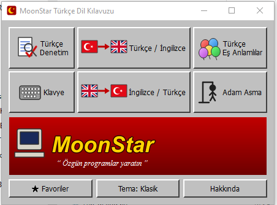
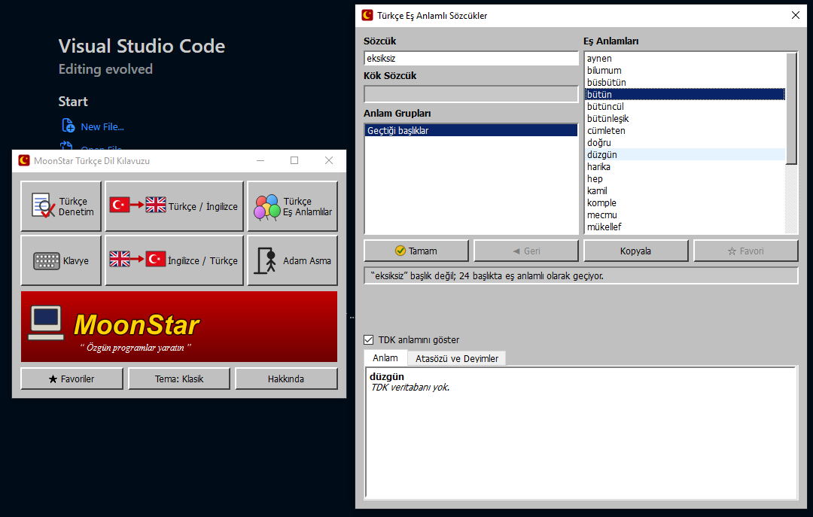
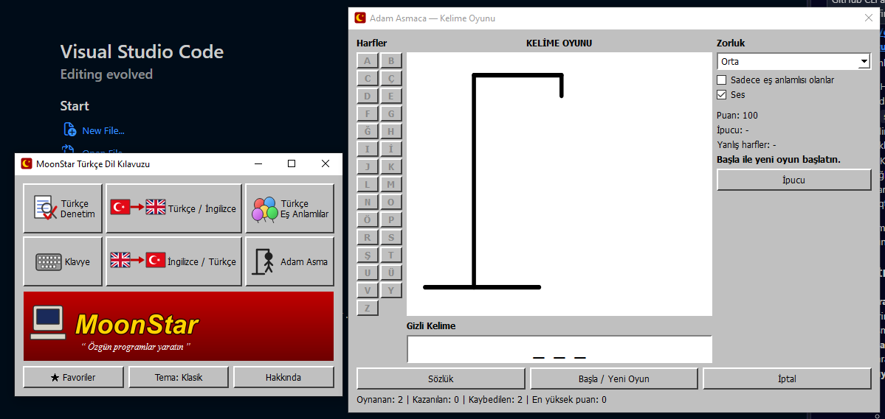

# MoonStar Türkçe Dil Kılavuzu — PyQt6

1990'ların MoonStar MTU Sözlük programının görünümünü ve çalışma mantığını yeniden kuran masaüstü uygulaması.



<p>


</p>

```
pip install -r requirements.txt
python main.py
```

## Pencereler
- **Türkçe Eş Anlamlılar**: Sözcük, Kök Sözcük, Anlam Grupları (1.Anlam, 2.Anlam, Türemiş), Eş Anlamları. Çift tıklayınca o sözcüğe geçer; Geri; TDK anlam paneli; sözcük başlık değilse "geçtiği başlıklar".
- **Türkçe/İngilizce** ve **İngilizce/Türkçe**: tam alfabetik liste, yazdıkça en yakın sözcüğe kayar, numaralı karşılıklar.
- **Adam Asma**: 6 hata, harf düğmeleri ve klavye, ipucu (-20 puan), zorluk, istatistikler, MT1-MT4.WAV sesleri.
- **Klavye**: ekran Türkçe Q / F klavyesi.
- **Türkçe Denetim**: bilinmeyen sözcükleri çizer, öneri sunar (sezgisel; tam morfolojik değil).
- **Favoriler**: her pencerede ☆ düğmesi; `user_data.sqlite` içinde saklanır.
- **Tema**: Klasik (Win95) ve Karanlık.

## Veri
Veritabanları bu depoda `data/` klasöründe hazır gelir (`moonstar_all.sqlite`, `synonyms_final.sqlite`); ek bir şey indirmeden çalışır.

İsteğe bağlı (depoda yok, `moonstar_qt` klasörünün üstüne koyun):
- `MT1.WAV` … `MT4.WAV`: Adam Asma oyun sesleri
- `guncel-turkce-sozluk-master/sozluk/v12/v12.gts.sqlite3.db`: TDK anlam paneli için

## Dosyalar
`main.py` başlatıcı · `data.py` veri katmanı · `audio_player.py` ses · `theme.py` temalar · `icons.py` çizilmiş görseller ·
`*_dialog.py` pencereler · `widgets.py` ortak bileşenler.
